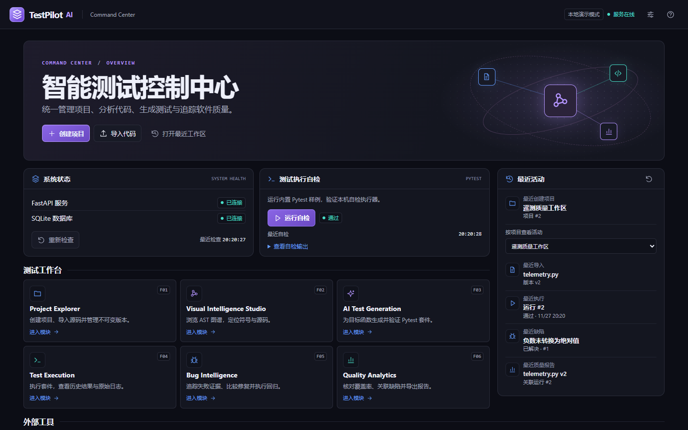

# TestPilot AI

TestPilot AI 是面向 Python 开发与测试人员的本地工作台。它把源码版本、AST 分析、测试生成、真实 Pytest 执行、缺陷修复回归和质量报告关联起来。导入一个缺陷版与一个修复版即可复验同一失败节点，判断修复后该用例是否通过。变异测试进一步衡量现有断言对代码变化的检出能力。

[教师验收入口](docs/COURSE_REQUIREMENTS_MAPPING.md) · [规格及验收条件](docs/SPEC.md) · [架构](docs/ARCHITECTURE.md) · [正式汇报与演示](presentation/README.md) · [最终仓库审计](docs/COURSE_REPOSITORY_AUDIT.md)



## Windows 11 安装与启动

需要 Python 3.13。使用 PyCharm 打开仓库根目录，新建基于 Python 3.13 的项目虚拟环境，或选择现有的 `.venv\Scripts\python.exe`。通过 PyCharm 的 **Install requirements** 安装根目录依赖。若通过 PowerShell 创建环境，将 `C:\path\to\python.exe` 换成已安装的 Python 3.13 解释器：

```powershell
& 'C:\path\to\python.exe' -m venv .venv
.\.venv\Scripts\python.exe -m pip install -r requirements.txt
.\.venv\Scripts\python.exe -m pip check
```

打开根目录 `main.py` 后点击 **Run**。也可使用共享运行配置 **TestPilot AI**。单个 Uvicorn 进程启动后会在默认浏览器打开 [工作台](http://127.0.0.1:8000/)。在首页点击 **运行自检**，该流程在临时目录执行仓库固定样例。点击 **Stop** 停止服务，再次点击 Run 可重启。

```powershell
.\.venv\Scripts\python.exe main.py --no-browser
```

`--no-browser` 适用于手动打开页面。端口已占用时可加 `--port 8001`。PyCharm 调试时用相同入口，运行参数填 `--mode dev`，可在 `backend/app.py` 的 `health` 路由设断点，并打开 `/docs`。默认数据库在 `data/testpilot.sqlite3`。设置 `TESTPILOT_DATA_DIR` 可指定独立的可写数据目录。

## 用一个缺陷验证完整流程

1. 在 **项目与文件** 创建项目并导入 [缺陷版 magnitude.py](eval/phase02/buggy/magnitude.py)。在 **代码分析** 核对函数、行号和源码约定。
2. 在 **测试生成** 为 `magnitude` 生成并验证套件。在 **测试执行** 查看失败断言、节点、日志和覆盖率。模板流程无需模型权重。
3. 从失败节点 `test_example_3` 登记缺陷。在同一项目导入 [修复版同名文件](eval/phase02/fixed/magnitude.py)，在 **缺陷管理** 选择新版本并运行原套件。原失败节点通过后，缺陷才会转为已解决。
4. 在 **质量报告** 切换原始运行与回归运行并导出 JSON。核对运行 ID、节点和统计。通过率排除跳过，行覆盖率按可执行行计。
5. 进入 **智能测试引擎**，选择已导入文件和函数，选择 **仅本地模板** 并点击 **生成并运行**。任务完成后进入 **评估变异测试与补测**。查看原版校准与每个变异的状态，可下载按运行保存的 JSON。[现场演示手册](presentation/DEMO_RUNBOOK.md)

单文件导入支持 128 KiB 以内的 UTF-8 源码。FastAPI 同源提供 Jinja2 页面、前端静态资源和 API。SQLite 保存不可变源码版本、生成工件与运行关联。Wasmtime 中的 WASI CPython 隔离执行导入代码与测试，来宾无网络和子进程访问。首次执行会编译运行时缓存，预留约 336 MB 磁盘空间。适用的来宾 Hypothesis 用例记录为跳过，宿主属性测试单独执行。[功能与实测映射](docs/FEATURE_MAP.md)

## 本机 AI 分析、生成与修复

统一主模型为 **Qwen3.8-27B UD-IQ3_XXS**，由 `backend/model_provider.py` 经本机 Ollama/Vulkan 调用。部署守卫检查权重摘要、显存和专用回环进程。已有合格权重时，从根目录启动监督器，按本机实际路径替换模型目录：

```powershell
.\.venv\Scripts\python.exe -m eval.phase06.serve --models E:/OllamaModels
```

启动产品后访问 `/api/model/health`。在 **智能测试引擎** 选择 **使用本机 Qwen3.8-27B**，可用 AI 生成并运行测试。源码智能理解可通过 Demo Lab 的本机 AI 模式或 `POST /api/engine/files/{file_id}/understanding` 执行。F03 常规页面使用模板，F03 API 支持 `mode=ai`。在 **缺陷管理** 选失败记录，生成 AI 修复候选并审阅差异，应用后用原套件回归。F13 可将存活变异交给模型补测。模型错误会保留具体失败与生成来源。[部署、守卫与恢复](docs/phase06/DEPLOYMENT.md) · [真实 F05 修复与回执](reports/TP-F05-AI-REPAIR-001/TP_F05_AI_REPAIR_001_ACCEPTANCE.md)

## 复验与查看结果

Windows 浏览器测试使用已安装的 Microsoft Edge。完整流程需要 Node.js，课程 CI 固定 Python 3.13.11 和 Node.js 24.13.0。使用安装了依赖的项目解释器，在根目录执行：

```powershell
.\.venv\Scripts\python.exe hooks/verify.py --scope full --report reports/course-final/verify-full.txt
node --test tests/bug_diff.test.mjs
.\.venv\Scripts\python.exe -m eval.phase05.verify_frozen
.\.venv\Scripts\python.exe hooks/verify_member_logs.py
```

第一条命令已包含 Node 测试，会覆盖指定验收报告。只需定向复验时，运行 `.\.venv\Scripts\python.exe -m pytest -q tests/test_f05.py`。冻结评测复算已有 10 项目、3 种子、每组 117 个固定变异位置的历史记录。可分别查看[本轮全量报告](reports/course-final/verify-full.txt)、[成功 CI 回执](reports/TP-COURSE-REMEDIATION-001/ci-github/45992897616/receipt.json)和[冻结评测方法](eval/phase05/PROTOCOL.md)。

| 目录 | 教师可查内容 |
|---|---|
| `backend/`、`frontend/` | FastAPI、SQLite、WASI 执行器和同源工作台 |
| `tests/`、`eval/`、`demo/` | 工程回归、课程样例、冻结数据及演示实验室 |
| `docs/`、`reports/` | 规格、教师映射、部署和实际运行回执 |
| `collab-log/`、`transcripts/` | 五份个人日志、缺陷档案、原始 Prompt、关键输出及原生导出入口 |
| `.claude/`、`mcp-server/`、`hooks/`、`.github/` | 两个 Skill、自定义 Reviewer、MCP、确定性 Hook 与 CI |
| `presentation/` | 正式 PowerPoint、PDF、讲稿、演示手册与备用视频 |
