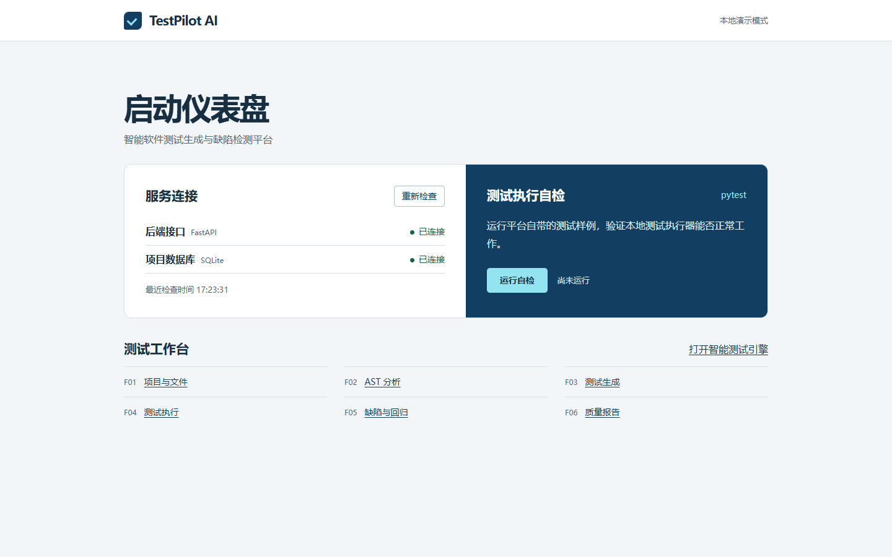

# TestPilot AI

智能软件测试生成与缺陷检测平台。在同一个本地工作台导入 Python 源码、查看 AST、生成并运行测试、确认缺陷、回归修复并导出质量报告。F13 通过变异测试评估套件，并可调用本机 Qwen3.8-27B 为存活变异追加测试。所有页面与 API 由根入口启动的 FastAPI 服务提供。

[产品规格](docs/SPEC.md) · [系统架构图](docs/ARCHITECTURE.md) · [课程验收](docs/COURSE_FINAL_REPORT.md) · [所有证据](docs/COURSE_EVIDENCE_INDEX.md) · [演示与汇报](presentation/README.md)



## Windows 11 上使用 PyCharm

1. 在 PyCharm 选择 **File → Open**，打开 `D:\TestPilot AI`。
2. 在 **Settings → Python → Interpreter**（部分版本显示为 **Project → Python Interpreter**）选择该项目的解释器。本机已经创建 `D:\TestPilot AI\.venv\Scripts\python.exe`。若列表中没有它，选择 **Add Local Interpreter → Existing** 并定位到该文件。
3. 在新电脑首次打开时，可用 Python 3.13 创建项目虚拟环境。打开根目录的 `requirements.txt`，使用 PyCharm 提示的 **Install requirements** 将依赖装入项目解释器。也可以在 Python Packages 窗口按文件逐项安装。已配置的环境只需执行下一步。
4. 打开根目录 `main.py`，点击绿色 **Run**。也可在工具栏选共享配置 **TestPilot AI** 后点击 Run。应用就绪后，默认浏览器会自动打开本地 Dashboard。[打开本机 Dashboard](http://127.0.0.1:8000/)
5. 确认“后端接口”和“项目数据库”均为“已连接”，点击 **运行自检**。按钮会调用后端，在临时目录运行仓库固定样例。点击 PyCharm 红色 **Stop** 即可停止；再次点击 Run 可重新启动。

## 演示、调试与常见问题

| 场景 | PyCharm 操作 / 预期 |
| --- | --- |
| 本机演示（默认） | 共享配置无参数。使用单个 Uvicorn 进程、普通日志和自动打开浏览器。 |
| 开发调试 | 在 **Run → Edit Configurations** 复制共享配置，Parameters 填 `--mode dev`。在 `backend/app.py` 的 `health` 函数体边栏设置断点，点击 **Debug**。入口探测或页面“重新检查”会触发断点，按 **F9** 继续。开发模式提供调试日志及 `/docs`。 |
| 端口被占用 | 查看 Run 控制台提示。停止自己启动的旧服务后重试；需要同时调试时，在副本配置填 `--port 8001`。 |
| 无浏览器或批量验收 | Parameters 可加 `--no-browser`，按日志中的地址访问。自动打开请求失败时日志也会给出地址。 |
| 缺少依赖 | 对照 Run 控制台首行与项目 Interpreter 路径，用该解释器安装根目录依赖。 |
| SQLite 初始化问题 | 默认路径为 `data/testpilot.sqlite3`。检查数据目录写权限、数据库版本和控制台异常。可在运行配置环境变量中用 `TESTPILOT_DATA_DIR` 指定独立数据目录。 |

## 用一个真实缺陷演示六个模块

1. 从仪表盘进入 **项目与文件**，创建项目并导入[缺陷版 magnitude.py](eval/phase02/buggy/magnitude.py)。文件中的 doctest 约定负数的绝对值应为正。
2. 在 **代码分析** 选择该版本，查看 `magnitude(x: int) -> int` 的签名和行号。进入测试生成，选择 `magnitude` 并点击 **生成并验证**。
3. 生成页显示套件编号、生成方式、真实首跑状态与测试源码。当前安装使用本地模板，无需模型密钥。首次运行会在本机编译并缓存 WASI 运行时，后续复用缓存。在 **测试执行** 查看失败节点、日志和实测行覆盖率。
4. 在 **缺陷管理** 从失败的 `test_example_3` 登记一个缺陷。回到原项目导入[修复版同名文件](eval/phase02/fixed/magnitude.py)，选择新版本并点击 **运行回归**。只有原套件和原失败节点在修复版上通过，缺陷才会显示已解决。
5. 在 **质量报告** 选择修复前或修复后的运行，核对通过、失败、错误、跳过及关联缺陷，下载同一份 JSON。通过率分母排除跳过项，覆盖率衡量该文件的可执行行。

单次导入支持 128 KiB 以内的 UTF-8 单文件。业务测试在独立 WASI CPython 中运行，仅挂载只读源码及测试依赖，禁用网络和子进程。依赖已安装后可离线执行。当前来宾不支持 Hypothesis 的原生扩展，适用的属性建议随套件保存，相应用例记录为跳过；普通测试继续执行。

## 模块与验收

### PHASE-03 智能测试引擎

按上述 PyCharm 步骤启动后，在仪表盘点击 **打开智能测试引擎**。选择已导入的文件版本及目标函数，选定生成方式和最多修正次数，点击 **生成并运行**。页面显示实际生成来源、Pytest 结果、行与分支覆盖，可下载测试文件和完整 JSON。历史记录保留首次运行和每次修正。AI 模式使用统一的本机 27B，模型不可用会显示错误。确定性模板仍可显式选择。[PHASE-06 本机部署](docs/phase06/DEPLOYMENT.md)

可用[快速排序样例](eval/phase03/quicksort/subject.py)验证正确实现，或导入[零输入异常契约样例](eval/phase03/repair/subject.py)，选择本地模板并允许一次修正，查看生成测试自身的错误、修正依据和两次执行。样例的公开函数名会出现在目标列表。七个样例的实际运行、缺陷归因及发布边界见[PHASE-03 验收报告](TP_PHASE_03_ACCEPTANCE.md)。

- [入口](main.py)和[共享运行配置](.run/TestPilot_AI.run.xml)控制本地启动。[后端](backend/)提供路由、数据库探测与固定自检，[前端](frontend/)由同一服务发布 Jinja2 模板、CSS 和 JavaScript。
- [架构](docs/ARCHITECTURE.md)、[功能映射](docs/FEATURE_MAP.md)、[三天计划](docs/THREE_DAY_PLAN.md)描述三天范围。[工作包](docs/work-packages/)和[贡献表](collab-log/member_contributions.md)列出负责人、实际操作和验收归属。
- [PHASE-02 验收报告](TP_PHASE_02_ACCEPTANCE.md)索引六个模块、真实回归记录及导出样本。[PHASE-01 历史报告](TP_PHASE_01_ACCEPTANCE.md)保留初始启动与环境验收证据。

可从 PyCharm 的测试运行配置执行 `tests/`。需要在 PowerShell 独立复验时，从项目根目录运行以下命令。本机浏览器验收采用已安装的 Microsoft Edge。

```powershell
.\.venv\Scripts\python.exe -m pytest tests -q
```

首次部署请为 WASI 运行时缓存预留约 336 MB 磁盘空间。执行器一次受理一个运行；繁忙时页面提示重试。日志达到限额会中止当前运行并记录证据不完整。

## PHASE-04 变异测试与本机 AI 补测

1. 在项目解释器中安装当前 `requirements.txt`。照常运行根目录 `main.py`，在 **智能测试引擎** 选择一个导入版本和顶层同步函数并完成测试任务。[六类变异示例](eval/phase04/bonus.py)
2. 在已完成任务中点击 **评估变异测试与补测**。保留“将存活变异提交本机模型补测”并选择 **创建并运行**。页面先列出全部位置，再在隔离执行器中验证原版基线，逐一运行变异副本。
3. 有存活变异时，F13 通过本机 Ollama 生成追加测试。页面列出前后结果，完整 JSON 提供每一位置的编辑、摘要、Pytest 节点、原版校准结果及模型记录。可终止会话，服务重启后可从已写入 SQLite 的检查点继续未结束的会话。

Qwen3.8-27B UD-IQ3_XXS 是统一主模型。使用本机 Ollama 与经核对的现存 GGUF，在项目解释器启动 `python -m eval.phase06.serve --models E:/OllamaModels`，按 PyCharm 主入口运行后访问 `/api/model/health`。监督器在专用回环端口 11763 验证权重、Vulkan 和宿主资源。智能引擎可选“使用已配置模型”。F03 常规工作台使用模板，F03 API 可显式传入 `mode=ai`。模板路径可独立完成 F01–F06 和 F13 初测。[当前部署](docs/phase06/DEPLOYMENT.md)

变异得分为杀死数除以清单总数。报告保留存活、执行错误、超时、终止、未运行及等价候选。得分变化只描述该版本、该算子配置和该组测试的实测效果。[选型实测](docs/phase04/TOOL_SELECTION.md) · [阶段验收](TP_PHASE_04_ACCEPTANCE.md)

## 课程评测与目录

对照使用 10 个冻结项目、3 个种子，每组 117 个预登记位置。0.5B 检出 0/117，模板 81/117，27B 初始 104/117，反馈后 105/117。RTX 5080 Laptop Vulkan 连续 10/10 响应通过，热请求首 Token 中位数 0.553 秒，热请求平均 19.21 token/s，严格源码理解 56/70。[历史对照与方法](reports/phase05/TP_PHASE_05_ACCEPTANCE.md) · [复验命令](docs/COURSE_TESTING.md)

| 目录 | 用途 |
|---|---|
| `backend/`、`frontend/` | FastAPI、SQLite、WASI 与工作台 |
| `tests/`、`eval/` | 工程回归、课程样例与冻结实验 |
| `docs/`、`reports/` | 规格、部署与原始验收 |
| `collab-log/`、`transcripts/` | 工作、缺陷与会话证据 |
| `.claude/`、`mcp-server/`、`hooks/` | 工程工具与用法 |
| `presentation/` | 截图、汇报与视频 |
