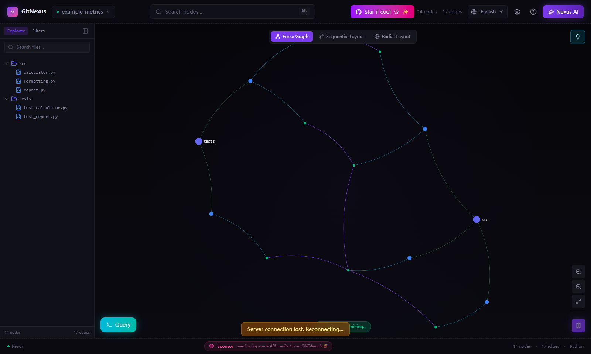
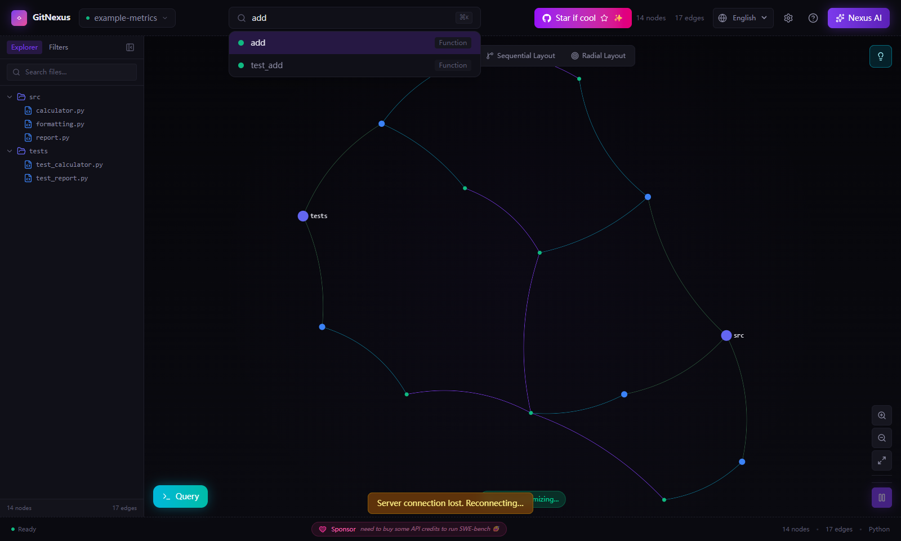
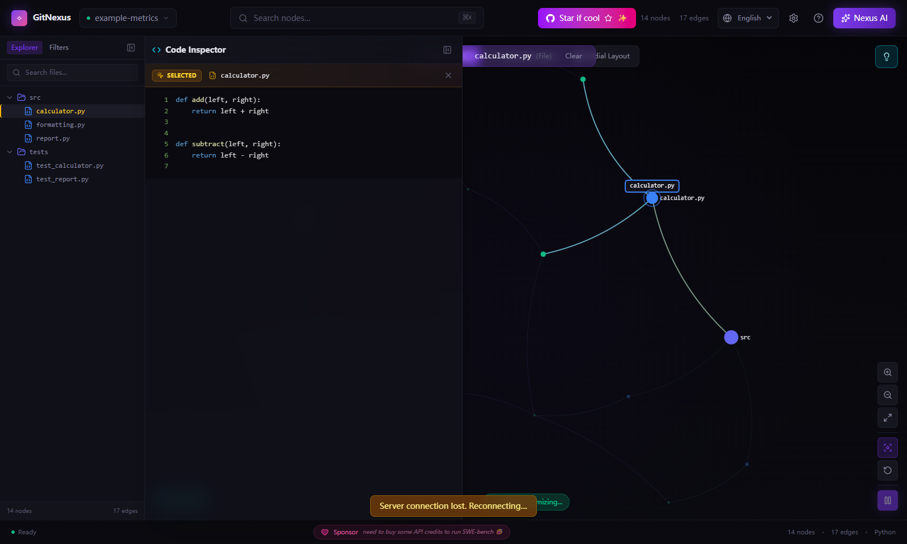
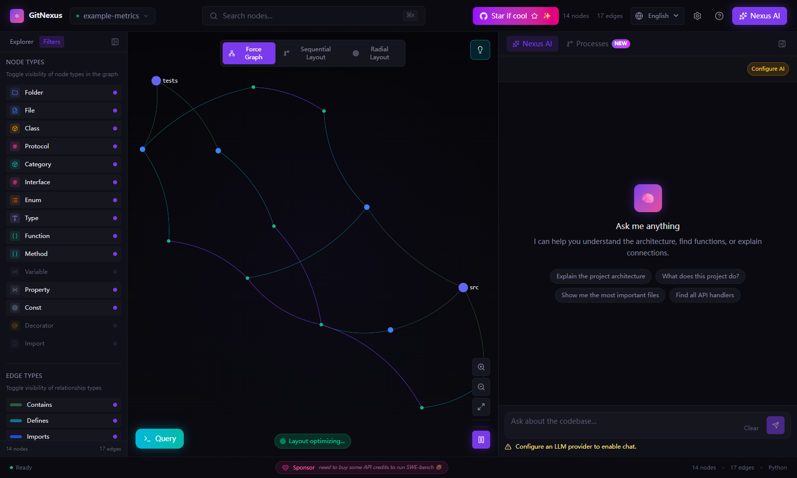

# GitNexus 前端设计审计与 TestPilot AI 评审摘要

**建议把“从符号找到证据”作为 F02 的设计中心，把“从一次运行查到缺陷、回归和报告”作为 F04–F06 的导航主线。** GitNexus 最值得借鉴的地方，是从不同入口选择同一个对象后，工作区仍能定位到同一份代码。TestPilot 的对象还带有项目、源码版本、套件和运行身份，保住这些关联比统一六页外观更重要。

**TESTPILOT-FRONTEND-REFERENCE-001 · WP02 · 2026-11-27**

工作包负责人为陈万策，实际研究与证据整理人为 Codex。陈帅廷协调阶段评审，成员人工复核与签收待进行。[工作包分配](../work-packages/WP02.md)

## 研究对象和证据口径

| 对象 | 本次核对与适用范围 |
| --- | --- |
| 用户指定 GitNexus | Windows 可读取 E 盘。`Get-Item -LiteralPath 'E:\Frontend-References\gitnexus'` 与父目录查询均返回路径不存在。无法核实该副本的版本、局部改动和运行画面。 |
| 公开 GitNexus | 独立临时检出上游提交 `26a404f21761925a13c4fa7cd0086465fa11f419`（UTC 2026-11-26，北京时间 2026-11-27），通过 `git ls-remote` 和 `git rev-parse HEAD` 核对。下文所有 GitNexus 源码链接指向这一个版本。结论可用于讨论公开版本，指定本地版本的一致性仍待确认。[公开提交](https://github.com/abhigyanpatwari/GitNexus/commit/26a404f21761925a13c4fa7cd0086465fa11f419) |
| TestPilot AI | `Get-Location` 为 `D:\TestPilot AI`。开始检查时 HEAD 为 `9f107cb`，存在其他任务的未跟踪文件，研究期间有并行提交。F01–F06 对照对象为已验收的 PHASE-02 工作台，前端实现可固定到 `f31a901`。本组结论针对六项业务及既有 P0 入口。[阶段验收](../../TP_PHASE_02_ACCEPTANCE.md) · [工作台入口](../../frontend/templates/workbench.html#L13) |
| 评审材料 | 审计区保存研究文档与截图。原理、界面状态和下一版建议分别凭固定源码、图下注记和设计验收条目复核。代码、组件和品牌素材均未移植到 TestPilot 产品。 |

## 关键截图：文件树、画布与选中对象

以下四图取自上述公开提交的独立临时运行副本。使用 Vite 在本机回环地址运行 Web 客户端，用 Edge 158.0.4370.33 无头模式和 Playwright 截取 1600 × 960、DPR 1、en-US 的原始窗口。项目、关系与文件内容由浏览器路由提供固定 JSON，用于重复选择、搜索与读取源码。示例有两个目录、五个文件、七个函数，共 14 个节点、17 条关系。此次没有索引仓库或连接模型。

**图 1 · 默认探索区。** 左侧文件树独占一栏，中央画布延展至右侧。布局切换贴近画布上缘，查询与缩放工具留在画布边缘。图底部同时出现 Ready 和重连提示：前者表示当前没有待显示的加载进度，后者源于示例心跳流提前结束后客户端重试，同场景的健康探针也返回 404。F04 可以据此把“已取得一次运行结果”和“目前能否联系服务”设计成两种独立状态。

**图 2 · 搜索范围。** 顶栏输入 `add` 后出现 `add`、`test_add` 两个函数，搜索菜单维持当前图视野。左栏的文件搜索依然独立。在 F02 提示“搜索当前版本的符号”，能让用户在输入前就知道哪些结果可能出现。

**图 3 · 选中后的代码检查。** 点击树中的 `calculator.py` 后，树行、图中节点与源码检查器指向同一文件。560 px 宽的检查器遮住一部分画布，代码行可读。F02 的用户需要持续比对源码，因而建议把源码提升为固定的中央阅读面，将补充信息放在可收起的详情区。

**图 4 · 同时打开筛选和右栏。** 点击 Filters，再点击 Nexus AI。健康探针和心跳采用成功样例，重连横幅消失。桌面实测左／中／右宽度分别为 256、744、600 px；左侧筛选节点和边，居中显示图，右侧放对话与流程标签。保持这两个面板打开，将同一窗口缩到 390 × 844 后，右栏仍宽 400 px，Sigma 容器宽度降为 0，控制台报告 `Sigma: Container has no width.`。这个特定展开态说明，TestPilot 的三栏应按**主区剩余宽度**退为单面板，并保留可重新打开索引的入口。[心跳处理](https://github.com/abhigyanpatwari/GitNexus/blob/26a404f21761925a13c4fa7cd0086465fa11f419/gitnexus-web/src/services/backend-client.ts#L738-L756)

当前 TestPilot 工作台提供两个直接对照。F02 已能指出 `magnitude` 定义跨第 1–11 行，仍需切换页面才能阅读原文，这是为源码留出中栏的理由。F06 的同一次失败运行既有 83.33% 通过率，也有 100% 单文件行覆盖率，所以图表应保留两套分母，以及下钻到原始运行的入口。两图均为 1366 × 900 的现有前端实拍，样例来源见[六页映射](TESTPILOT_PAGE_LAYOUT_MAPPING.md)。[F02 基线截图](screenshots/testpilot-f02-ast.png) · [F06 基线截图](screenshots/testpilot-f06-quality.png)

## 工作台究竟怎么排

顶部是仓库切换、节点搜索及帮助、设置等全局工具。主区使用水平 Flex。左侧是文件树与筛选器，中央的图谱取得全部剩余宽度。选中对象时，源码引用面板从**中央区域的左缘覆盖画布**。右侧另有可关闭的 Chat / Processes 面板，默认收起。页脚显示就绪状态和图统计。将源码当作固定中栏、将图谱当作固定右栏，会误判主要阅读面的可用宽度。[根布局](https://github.com/abhigyanpatwari/GitNexus/blob/26a404f21761925a13c4fa7cd0086465fa11f419/gitnexus-web/src/App.tsx#L363-L430) · [面板初始值](https://github.com/abhigyanpatwari/GitNexus/blob/26a404f21761925a13c4fa7cd0086465fa11f419/gitnexus-web/src/hooks/useAppState.tsx#L281-L285) · [右栏页签](https://github.com/abhigyanpatwari/GitNexus/blob/26a404f21761925a13c4fa7cd0086465fa11f419/gitnexus-web/src/components/RightPanel.tsx#L217-L266) · [状态栏](https://github.com/abhigyanpatwari/GitNexus/blob/26a404f21761925a13c4fa7cd0086465fa11f419/gitnexus-web/src/components/StatusBar.tsx#L31-L83)

| 区域 | 原实现尺寸与边界 | 对 TestPilot 的意义 |
| --- | --- | --- |
| 顶栏 | 内容与内边距决定高度，底部虚线，节点搜索 `flex-1 max-w-md`。顶部工具与范围内的搜索在同一条基线上。[顶栏](https://github.com/abhigyanpatwari/GitNexus/blob/26a404f21761925a13c4fa7cd0086465fa11f419/gitnexus-web/src/components/Header.tsx#L178-L204) · [搜索区域](https://github.com/abhigyanpatwari/GitNexus/blob/26a404f21761925a13c4fa7cd0086465fa11f419/gitnexus-web/src/components/Header.tsx#L469-L493) | 留给项目和版本足够空间。窄屏先换行，再收拢次要操作。 |
| 文件与筛选 | 左栏展开 `w-64`，收起 `w-12`，在默认 16 px 根字号下分别为 256、48 px。右边框分区，收起态仍有文件与筛选入口。[两种宽度](https://github.com/abhigyanpatwari/GitNexus/blob/26a404f21761925a13c4fa7cd0086465fa11f419/gitnexus-web/src/components/FileTreePanel.tsx#L309-L350) | F02 可复用折叠行为。F01 单文件导入只有文件名及版本，列表无需模拟仓库树。 |
| 图谱与源码 | 图容器 `min-w-0 flex-1`；源码浮层默认 560 px，鼠标可拖到 420–900 px，宽度可存入 localStorage。拖柄位于右边缘。[画布与叠层](https://github.com/abhigyanpatwari/GitNexus/blob/26a404f21761925a13c4fa7cd0086465fa11f419/gitnexus-web/src/App.tsx#L409-L424) · [宽度读写及拖动](https://github.com/abhigyanpatwari/GitNexus/blob/26a404f21761925a13c4fa7cd0086465fa11f419/gitnexus-web/src/components/CodeReferencesPanel.tsx#L124-L169) · [拖柄](https://github.com/abhigyanpatwari/GitNexus/blob/26a404f21761925a13c4fa7cd0086465fa11f419/gitnexus-web/src/components/CodeReferencesPanel.tsx#L459-L469) | F02 以源码为主阅读面，优先保证其可见宽度。可以提供离散的收起／展开控件和键盘操作，让行号定位始终可用。 |
| 右栏与窄屏 | 右栏声明为 40%，最小 400 px、最大 600 px。顶栏有局部 `sm:inline`，页脚有 `md:inline`。这些仅证明局部适配。在 375 px 视口单是右栏最小宽度就超过画布可用宽度。[右栏尺寸](https://github.com/abhigyanpatwari/GitNexus/blob/26a404f21761925a13c4fa7cd0086465fa11f419/gitnexus-web/src/components/RightPanel.tsx#L217-L224) · [局部断点](https://github.com/abhigyanpatwari/GitNexus/blob/26a404f21761925a13c4fa7cd0086465fa11f419/gitnexus-web/src/components/Header.tsx#L533-L544) · [页脚断点](https://github.com/abhigyanpatwari/GitNexus/blob/26a404f21761925a13c4fa7cd0086465fa11f419/gitnexus-web/src/components/StatusBar.tsx#L56-L68) | 双／三栏应有可用宽度门槛，在小屏保留原生导航和可顺序阅读的证据。详见[六页映射](TESTPILOT_PAGE_LAYOUT_MAPPING.md)。 |

## 视觉语言与实现

| 观察面 | 源码事实与借鉴边界 |
| --- | --- |
| 背景与状态色 | void、deep、surface、elevated、hover 由 `#06060a` 过渡至 `#1c1c28`；边框为 `#1e1e2a`、`#2a2a3a`，主要文字为 `#e4e4ed`，强调紫为 `#7c3aed`。文件、类、函数有各自类型色；连接指示另用绿／红。TestPilot 采用“层级与语义分开命名”的做法，把彩色状态留给真实结果。[主题颜色](https://github.com/abhigyanpatwari/GitNexus/blob/26a404f21761925a13c4fa7cd0086465fa11f419/gitnexus-web/src/index.css#L6-L35) · [连接状态](https://github.com/abhigyanpatwari/GitNexus/blob/26a404f21761925a13c4fa7cd0086465fa11f419/gitnexus-web/src/components/SettingsPanel.tsx#L427-L439) |
| 字体与密度 | HTML 请求 Outfit、JetBrains Mono，CSS 声明系统回退。源码阅读器为 13 px、1.6 行高，状态栏 11 px；主工具与辅助信息有字号差。中文路径、长 nodeid 和堆栈需要用本地字体实际验读。[字体请求](https://github.com/abhigyanpatwari/GitNexus/blob/26a404f21761925a13c4fa7cd0086465fa11f419/gitnexus-web/index.html#L6-L12) · [代码字体](https://github.com/abhigyanpatwari/GitNexus/blob/26a404f21761925a13c4fa7cd0086465fa11f419/gitnexus-web/src/components/CodeReferencesPanel.tsx#L32-L49) · [状态栏](https://github.com/abhigyanpatwari/GitNexus/blob/26a404f21761925a13c4fa7cd0086465fa11f419/gitnexus-web/src/components/StatusBar.tsx#L31-L38) |
| 尺寸、边框、阴影 | 顶栏图标按钮用 `h-9 w-9 rounded-md`，搜索框用 `px-3.5 py-2 rounded-lg`，结果菜单采用更大圆角和阴影，设置弹窗有 `max-h-[90vh]` 及较强阴影。细边界常驻，阴影强化浮层。TestPilot 的控件尺度、焦点环与留白见[设计系统提案](FRONTEND_DESIGN_SYSTEM_PROPOSAL.md)。[输入与结果菜单](https://github.com/abhigyanpatwari/GitNexus/blob/26a404f21761925a13c4fa7cd0086465fa11f419/gitnexus-web/src/components/Header.tsx#L469-L499) · [工具按钮](https://github.com/abhigyanpatwari/GitNexus/blob/26a404f21761925a13c4fa7cd0086465fa11f419/gitnexus-web/src/components/Header.tsx#L557-L576) · [弹窗表面](https://github.com/abhigyanpatwari/GitNexus/blob/26a404f21761925a13c4fa7cd0086465fa11f419/gitnexus-web/src/components/SettingsPanel.tsx#L379-L399) |
| 状态与动画 | CSS 定义 0.3 秒滑入／淡入和循环发光，也响应减少动画偏好；进度面板显示消息、数值和可用统计。连接失败有单独恢复路径，重连提示可保留探索界面。TestPilot 的无进度请求只显示等待文字。[动效与偏好](https://github.com/abhigyanpatwari/GitNexus/blob/26a404f21761925a13c4fa7cd0086465fa11f419/gitnexus-web/src/index.css#L40-L123) · [加载界面](https://github.com/abhigyanpatwari/GitNexus/blob/26a404f21761925a13c4fa7cd0086465fa11f419/gitnexus-web/src/components/LoadingOverlay.tsx#L27-L69) · [连接失败](https://github.com/abhigyanpatwari/GitNexus/blob/26a404f21761925a13c4fa7cd0086465fa11f419/gitnexus-web/src/App.tsx#L265-L283) · [重连反馈](https://github.com/abhigyanpatwari/GitNexus/blob/26a404f21761925a13c4fa7cd0086465fa11f419/gitnexus-web/src/App.tsx#L429-L442) |

该版本使用 React、TypeScript、Vite 和 Tailwind v4。App 编排进入、加载、探索三种视图，Context 维护选择和面板状态，组件处理局部交互。Lucide React 提供线性图标，Prism 语法高亮展示只读源码。源码绑定及样式类可以验证这些工具实际参与渲染。TestPilot 当前的 Jinja 页面、同源 CSS 和按页加载的 JS 能承载这里提出的布局及交互，迁移框架没有列入本方案。[依赖清单](https://github.com/abhigyanpatwari/GitNexus/blob/26a404f21761925a13c4fa7cd0086465fa11f419/gitnexus-web/package.json#L17-L73) · [Vite 插件配置](https://github.com/abhigyanpatwari/GitNexus/blob/26a404f21761925a13c4fa7cd0086465fa11f419/gitnexus-web/vite.config.ts#L1-L18) · [视图分派](https://github.com/abhigyanpatwari/GitNexus/blob/26a404f21761925a13c4fa7cd0086465fa11f419/gitnexus-web/src/App.tsx#L334-L369) · [代码高亮渲染](https://github.com/abhigyanpatwari/GitNexus/blob/26a404f21761925a13c4fa7cd0086465fa11f419/gitnexus-web/src/components/CodeReferencesPanel.tsx#L522-L566) · [现有按页加载](../../frontend/static/workbench.js#L89)

图数据通过 Graphology 表示，Sigma 绘制节点和曲线边。图适配器保存类型、路径和行信息，按关系构造边；图组件支持力导向、顺序和放射布局，力导向使用 ForceAtlas2 worker。点击节点打开源码，悬停显示名称，空白处清除选择。帮助文本明确区分滚轮缩放与拖动画布平移，工具按钮还支持放大、缩小和复位；未取得手拖单个节点并保存坐标的应用证据。[节点与边](https://github.com/abhigyanpatwari/GitNexus/blob/26a404f21761925a13c4fa7cd0086465fa11f419/gitnexus-web/src/lib/graph-adapter.ts#L245-L351) · [Sigma 实例](https://github.com/abhigyanpatwari/GitNexus/blob/26a404f21761925a13c4fa7cd0086465fa11f419/gitnexus-web/src/hooks/useSigma.ts#L393-L416) · [布局 worker](https://github.com/abhigyanpatwari/GitNexus/blob/26a404f21761925a13c4fa7cd0086465fa11f419/gitnexus-web/src/hooks/useSigma.ts#L1438-L1470) · [选择处理](https://github.com/abhigyanpatwari/GitNexus/blob/26a404f21761925a13c4fa7cd0086465fa11f419/gitnexus-web/src/components/GraphCanvas.tsx#L96-L125) · [布局切换](https://github.com/abhigyanpatwari/GitNexus/blob/26a404f21761925a13c4fa7cd0086465fa11f419/gitnexus-web/src/components/GraphCanvas.tsx#L301-L349) · [平移与缩放说明](https://github.com/abhigyanpatwari/GitNexus/blob/26a404f21761925a13c4fa7cd0086465fa11f419/gitnexus-web/src/locales/en/help.json#L59-L64) · [相机控制](https://github.com/abhigyanpatwari/GitNexus/blob/26a404f21761925a13c4fa7cd0086465fa11f419/gitnexus-web/src/hooks/useSigma.ts#L1531-L1543)

## 十项优先借鉴的设计

| 顺序 | GitNexus 机制 | 在 TestPilot 中怎样用、如何判断有效 |
| --- | --- | --- |
| 1 | 以稳定仓库身份恢复当前对象。[URL 恢复](https://github.com/abhigyanpatwari/GitNexus/blob/26a404f21761925a13c4fa7cd0086465fa11f419/gitnexus-web/src/App.tsx#L147-L161) | 六页沿用项目、文件版本及适用的运行 ID；刷新 F05 原始运行链接后仍能看到相同 nodeid。 |
| 2 | 树和图共享选择，树可展开到当前文件。[展开选中路径](https://github.com/abhigyanpatwari/GitNexus/blob/26a404f21761925a13c4fa7cd0086465fa11f419/gitnexus-web/src/components/FileTreePanel.tsx#L249-L278) | F02 符号列表和只读源码共享文件版本与源行。选择同名方法时，限定名和行号应能分辨。 |
| 3 | 代码引用携带行范围，并滚动到命中位置。[定位行](https://github.com/abhigyanpatwari/GitNexus/blob/26a404f21761925a13c4fa7cd0086465fa11f419/gitnexus-web/src/components/CodeReferencesPanel.tsx#L395-L419) | F02、F03 和 F05 共用只读查看器，显示版本、行号与来源。测试切换 v1/v2，核对高亮只属于当前版本。 |
| 4 | 全局节点搜索独立于文件树搜索，支持快捷键和键盘选定。[限定十条结果](https://github.com/abhigyanpatwari/GitNexus/blob/26a404f21761925a13c4fa7cd0086465fa11f419/gitnexus-web/src/components/Header.tsx#L92-L100) · [快捷键与选择](https://github.com/abhigyanpatwari/GitNexus/blob/26a404f21761925a13c4fa7cd0086465fa11f419/gitnexus-web/src/components/Header.tsx#L133-L175) | F02 先做“当前版本符号”搜索，明确范围；上下键、Enter、Escape 均可操作，无命中可清除条件。 |
| 5 | 文件与筛选共用一块可收起侧栏。[侧栏两种入口](https://github.com/abhigyanpatwari/GitNexus/blob/26a404f21761925a13c4fa7cd0086465fa11f419/gitnexus-web/src/components/FileTreePanel.tsx#L309-L374) | F02、F05 将次要过滤控件收起后，主阅读区扩展，当前选中对象保持；窄屏独立打开筛选。 |
| 6 | 对象类别、关系和邻域深度各有筛选维度。[类型与深度](https://github.com/abhigyanpatwari/GitNexus/blob/26a404f21761925a13c4fa7cd0086465fa11f419/gitnexus-web/src/components/FileTreePanel.tsx#L419-L519) | F02 借鉴筛选维度拆分，先支持当前返回的函数、类等符号类型；F05 可按真实缺陷状态筛选。 |
| 7 | 把有上下文的工具放在画布边缘，提供恢复视野的入口。[画布操作](https://github.com/abhigyanpatwari/GitNexus/blob/26a404f21761925a13c4fa7cd0086465fa11f419/gitnexus-web/src/components/GraphCanvas.tsx#L400-L449) | F02 只在存在相应视图时提供局部工具；日志或代码显示折行、定位选中行等阅读动作。 |
| 8 | 平时留出连续工作区，遇到具体对象才打开检查面板。[条件性源码叠层](https://github.com/abhigyanpatwari/GitNexus/blob/26a404f21761925a13c4fa7cd0086465fa11f419/gitnexus-web/src/App.tsx#L411-L427) | F03 让源码和配置相邻，生成后给测试源码完整阅读宽度。F05 在列表旁查看详情，按需比较来源版和修复版。 |
| 9 | 将等待过程、成功状态与连接错误放在不同位置。[加载详情](https://github.com/abhigyanpatwari/GitNexus/blob/26a404f21761925a13c4fa7cd0086465fa11f419/gitnexus-web/src/components/LoadingOverlay.tsx#L29-L69) · [重连横幅](https://github.com/abhigyanpatwari/GitNexus/blob/26a404f21761925a13c4fa7cd0086465fa11f419/gitnexus-web/src/App.tsx#L431-L440) | F04 提交后保留套件与目标版本，完成后展示真实日志；请求失败处保留错误，断言失败处提供缺陷入口。 |
| 10 | 大图未加载时，隐藏可能误报为零的统计。[按图模式显示统计](https://github.com/abhigyanpatwari/GitNexus/blob/26a404f21761925a13c4fa7cd0086465fa11f419/gitnexus-web/src/components/Header.tsx#L544-L554) | F06 让“未采集覆盖率”与实测 0% 拥有不同文本和图形状态；核对数据源、计量范围与 JSON 导出一致。 |

## 不适合直接采用的设计

| 不采用的做法 | 业务原因与替代 |
| --- | --- |
| 六页固定为仓库树、知识图和聊天窗 | 文件导入围绕 Python 单文件的不可变版本；测试运行、缺陷和报告的核心对象是记录。F01 用文件版本列表，F04–F06 用可回查的运行身份。[文件导入页面](../../frontend/templates/projects.html#L5) · [执行结果](../../frontend/templates/runs.html#L9) |
| 用图中邻近节点表达 AST 调用或测试因果 | 当前 F02 的符号、限定名和行号能支撑导航。跨文件调用关系、缺陷因果需独立数据依据；未经验证的边不能用于说明失败。[符号索引](../../frontend/static/analysis.js) |
| 永久悬浮查询框、全站图数据库查询入口、外部模型设置 | 测试生成、执行和回归已有明确流程与限制。保留页面内的明确动词、固定模式及受限执行边界。[生成配置](../../frontend/templates/generation.html) · [执行验收](../../F04_MODULE_ACCEPTANCE.md) · [查询浮层](https://github.com/abhigyanpatwari/GitNexus/blob/26a404f21761925a13c4fa7cd0086465fa11f419/gitnexus-web/src/components/QueryFAB.tsx#L194-L248) |
| 全站外部字体、霓虹发光、持续脉冲及赞助入口 | 本地演示要求离线可读，长时间核对 Diff、日志需要稳定背景。继承项目本机字体栈，把颜色优先留给状态，把动效保留给用户触发的展开。[现有样式](../../frontend/static/dashboard.css#L1) · [底部视觉元素](https://github.com/abhigyanpatwari/GitNexus/blob/26a404f21761925a13c4fa7cd0086465fa11f419/gitnexus-web/src/components/StatusBar.tsx#L53-L68) |
| 照搬右栏的 400 px 下限，将只读源码窗扩大为可写编辑器，或在 F04 等待期间模拟逐行输出 | 在窄屏改为抽屉或上下布局。保留只读源码；F04 同步执行结束后才有已保存的日志，界面等待态不能显示伪造的时间线。[运行契约](../../backend/runs.py#L47) · [窄屏与页面验收](TESTPILOT_PAGE_LAYOUT_MAPPING.md) |

## 六页结论与交付入口

| 页面 | 推荐给人工评审的布局 |
| --- | --- |
| F01 项目中心 | 统一项目入口 → 文件和不可变版本清单 → 所选版本的源码预览与“分析此版本”。 |
| F02 AST 分析 | 宽屏“符号索引／带行号源码／选中符号详情”；窄屏顺序阅读，按需显示索引和详情。 |
| F03 测试生成 | 源码和配置并排，生成后下部全宽展示生成建议、测试源码、静态检查和真实首跑结果。 |
| F04 测试执行 | 上方启动与状态区，历史运行选择联动摘要、用例和完成日志。未来若提供事件接口，再单独验收流式日志。 |
| F05 缺陷管理 | 缺陷列表 + 当前缺陷详情，详情串起原失败与回归；从一次明确的版本比较打开只读 Diff。 |
| F06 质量分析 | 先选一次真实运行，再看用例构成、通过率和单文件覆盖率，沿链接回查原始证据或导出。 |

[逐页字段、布局与验收](TESTPILOT_PAGE_LAYOUT_MAPPING.md) · [公共组件、状态和优先级](COMPONENT_INVENTORY.md) · [设计变量与可访问性验收](FRONTEND_DESIGN_SYSTEM_PROPOSAL.md) · [按 F01–F06 逐页迁移、回归与回退](FRONTEND_UPGRADE_ROADMAP.md)

全站先统一项目／版本选择、记录链接、只读证据查看、状态反馈这四组公共能力。之后逐页加入确有业务需求的符号筛选、结果用例表、Diff 与指标图。每批保留 P0 单服务入口、现有路由和 API 契约，交付单页回归证据后再继续。最终用同一份失败样例走完登记缺陷、修复回归、导出报告，以 run ID 和版本摘要核对全链路。实施需另行人工确认。

## 评审记录

| 检查 | 本轮实际结果 |
| --- | --- |
| 引用与图片 | 对照固定检出逐条检查源码路径与行号，核对仓库相对链接。四张 GitNexus 与两张 TestPilot PNG 均经解码和目视检查。 |
| 操作抽查 | 上游版本已在本地浏览器实拍探索、搜索、选中文件、筛选与打开右栏，并观察了窄屏画布宽度。TestPilot 实拍 F02 和 F06 的样例状态。全站改造后的回归属于后续阶段。 |
| Git 归档 | 操作人 Codex。研究包可用 `git log -1 --name-status -- docs/TESTPILOT-FRONTEND-REFERENCE-001` 核查。 |
| 范围及停止点 | 公开提交版研究材料状态为 `READY_FOR_TESTPILOT_FRONTEND_DESIGN_REVIEW`。指定 E 盘副本的来源一致性待路径恢复或负责人确认采用上述提交。人工签收与改造开工均待确认。 |
