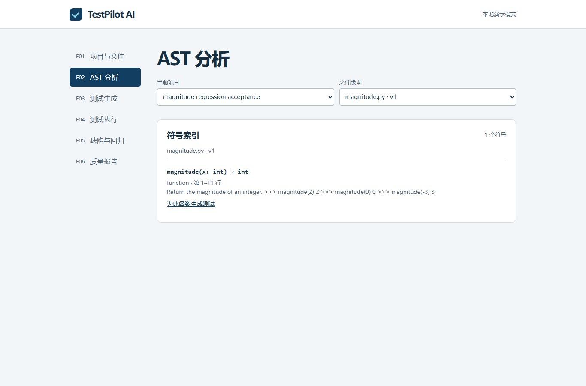
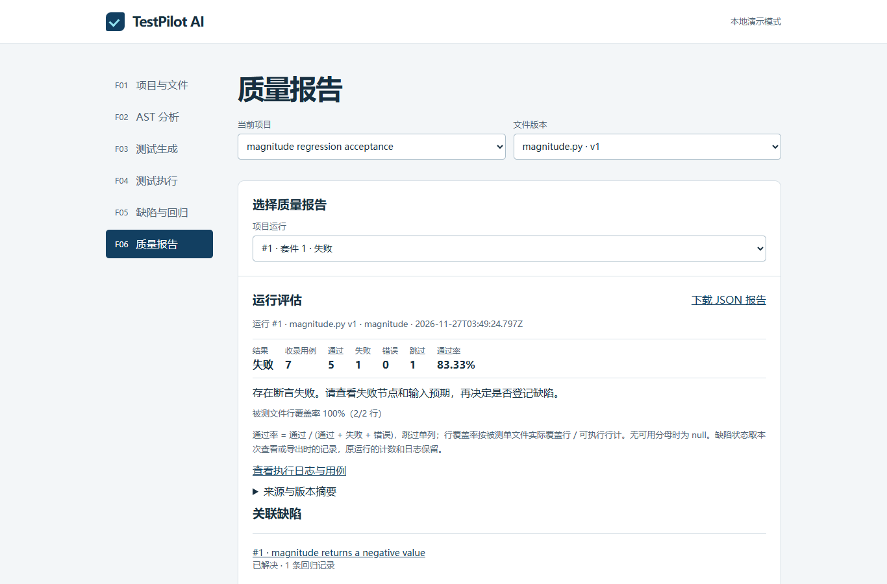

# TestPilot AI 六个页面的布局与数据映射

TESTPILOT-FRONTEND-REFERENCE-001 · WP02 产品交互 · 操作人 Codex · 供产品与工程共同评审

工程页面由同一个工作台模板渲染。顶栏显示运行模式，模块导航下的正文有项目与文件版本选择器、状态通知区及对应模块模板。现有链接通过查询参数传递项目和文件，模块可再附加符号、套件、运行或缺陷标识。建议沿用这组深链接，让用户刷新、后退或从报告追溯时能回到同一份证据。[模板 14–35 行](../../frontend/templates/workbench.html#L14) · [链接构造 27–33 行](../../frontend/static/workbench.js#L27) · [模块与工作包对应表](../FEATURE_MAP.md)

下表与各页“建议”均为待评审设计。GitNexus 参考来自下文所链上游固定提交，用户指定的本地副本尚待版本核对。TestPilot 现状依据仓库源码和既有验收样本。

| 入口 | 主区域与阅读次序 | 选择后应能回答的问题 |
| --- | --- | --- |
| F01 项目中心 · `/workbench/projects` | 项目列表 → 同名文件的版本清单 → 选中版本预览 | 我要分析哪个项目的哪一版？ |
| F02 AST 分析 · `/workbench/analysis` | 文件与符号索引 ｜ 源码 ｜ 符号详情 | 这个定义在哪里，它接受哪些参数？ |
| F03 测试生成 · `/workbench/generation` | 目标源码 ｜ 生成配置；下方为测试源码及验证记录 | 为哪个目标生成了什么，真实首跑怎样？ |
| F04 测试执行 · `/workbench/runs` | 执行表单 → 运行历史与详情 → 用例、日志 | 哪个套件在哪个文件版本上失败？ |
| F05 缺陷与回归 · `/workbench/bugs` | 缺陷列表 ｜ 证据和回归详情；详情内按需对照版本 | 哪条断言失败，修复后用同一套件复核了吗？ |
| F06 质量分析 · `/workbench/reports` | 运行选择与导出 → 结果分布和覆盖 → 缺陷、原始证据 | 本次测试实际覆盖多少，哪些风险仍在？ |

## F01　用项目与版本建立统一入口

**入口对照。** PHASE-01 验收保存的 1366 × 900 桌面截图中，首页把“服务连接”和“测试执行自检”并排展示，底部六项当时仍标为“业务模块规划”；它可用于核对首页与项目中心的职责分工。[历史仪表盘截图](../../reports/dashboard.png) · [PHASE-01 截图来源](../../TP_PHASE_01_ACCEPTANCE.md#L28)

**现状。** 首页已链接各模块；项目页已有创建、导入和源码预览。文件清单按项目返回，物理记录使用文件 ID 和版本号标识。与同名文件的最新版本内容相同会复用该版本，内容变化则增加版本号。导入接口接受单个文件名，对路径、扩展名、编码、内容大小等有校验。[首页模块入口](../../frontend/templates/dashboard.html#L56) · [项目页](../../frontend/templates/projects.html#L1) · [文件列表及导入 51–85 行](../../backend/projects.py#L51)

**建议。** 从 Dashboard 的“项目与文件”进入项目清单。选择项目后，主列按文件名聚合，展开才看历史版本；行内显示版本号，右侧显示只读源码、完整摘要与“分析此版本”。在文件区顶部放置导入操作，在项目区保留创建操作。GitNexus 的仓库选择入口让用户先确定所研究的对象；TestPilot 的工作对象要再细一层，必须明确选中的文件版本。平铺导入文件缺少目录层级，界面以文件和版本分组即可。[GitNexus RepoLanding 选择仓库](https://github.com/abhigyanpatwari/GitNexus/blob/26a404f21761925a13c4fa7cd0086465fa11f419/gitnexus-web/src/components/RepoLanding.tsx#L125-L136)

**异常与小屏。** 无项目时显示创建表单；空项目定位到导入按钮，提示 UTF-8、单个 .py、128 KiB。重名项目、编码错误或超限时把原因留在表单边，保留当前选择。窄屏依次显示项目选择、版本清单、可展开预览。验收可导入同一文件两次，再导入一个字节不同的同名版本；检查前两次复用、第三次新增、旧版仍可查看。[页面读取和导入](../../frontend/static/workbench.js#L66) · [既有版本测试](../../tests/test_f01.py#L18)

## F02　宽屏采用三栏 AST 工作台

图中是当前模板。用既有静态分析器读取验收样例 `magnitude.py`，得到一个顶层函数和第 1–11 行的范围；目前要看这十一行原文，用户需要离开该页。截图在 Edge 158、1366 × 900、DPR 1 下拍摄，独立回环服务向原页面脚本提供只读样例响应。[源码样例](../../eval/phase02/buggy/magnitude.py) · [静态分析实现](../../backend/analysis.py)

**现状。** API 给出文件身份与摘要、带限定名和起止行的类、同步函数及异步函数，以及参数、返回注解和文档字符串。语法或分析失败可返回消息及可空的行列号。当前页把符号渲染为列表，只有顶层同步函数可继续生成测试。[分析输出 29–64 行](../../backend/analysis.py#L29) · [当前列表与下一步链接](../../frontend/static/analysis.js#L17)

**建议。** 主区可用宽度足以同时容纳约 220、420、260 px 及间隔时，左列列出本项目文件版本及当前版本内的符号；中间留最大空间用于带行号源码；右列显示所选符号、签名、注解、说明和适用的下一步。条件与嵌套定义可能导致同名条目，选中键应至少包含版本、限定名和起始行。鼠标和键盘选择都应滚动到同一源码范围，高亮跨多行定义。GitNexus 把资源、主体与可关闭详情分开，也能按文件及代码范围聚焦；AST 页借用定位动作，让源码成为主体。现有分析返回的符号记录没有调用关系字段，调用图缺少数据依据。[GitNexus 工作台分区](https://github.com/abhigyanpatwari/GitNexus/blob/26a404f21761925a13c4fa7cd0086465fa11f419/gitnexus-web/src/App.tsx#L407-L425) · [按文件和行范围定位引用](https://github.com/abhigyanpatwari/GitNexus/blob/26a404f21761925a13c4fa7cd0086465fa11f419/gitnexus-web/src/components/CodeReferencesPanel.tsx#L185-L198)

**异常与小屏。** 空符号列表仍可读源码；语法错误发生时把可用行列标到原文，位置缺失时只给错误信息。宽度不足先收起详情，手机用“符号 / 源码 / 详情”单面板切换并保留选择。验收分别选中同一文件中的类、方法和顶层函数，核对行区间与生成入口；用空文件及语法错误样本验证阅读路径。[分析异常及无符号状态](../../frontend/static/analysis.js#L9) · [既有分析用例](../../tests/test_f02.py#L4)

## F03　配置贴近源码，结果占据完整阅读宽度

**现状。** 当前页面以文件 ID 获取分析结果与套件列表，仅选择顶层同步函数；提交载荷固定为目标与 `mode: "template"`。后端静态检查源码并保存套件，再关联真实首跑；候选套件和首次执行结果可分别回读。页面也处理无首跑记录和执行器忙。[生成表单与结果 3–43 行](../../frontend/static/generation.js#L3) · [静态检查与首跑关联 114–157 行](../../backend/generation.py#L114) · [生成模块验收](../../F03_MODULE_ACCEPTANCE.md)

**建议。** 上半区左边展示选中函数的只读源码与起止行；右边显示文件版本、目标选择器和固定模板模式，保留“生成并验证”主按钮。下半区整行用于套件历史选择、生成的测试源码、生成建议、静态检查结论以及可跳到 F04 的首跑编号和状态。可借鉴 GitNexus 用标签收纳次要内容的方式，将长建议折叠；代码摘要、生成模式、静态结论与真实运行结论各有明确标签。固定模式只读呈现，避免诱导用户调整无对应字段的模型或采样参数。[GitNexus 右栏标签切换](https://github.com/abhigyanpatwari/GitNexus/blob/26a404f21761925a13c4fa7cd0086465fa11f419/gitnexus-web/src/components/RightPanel.tsx#L220-L255)

**异常与小屏。** 无可用函数时说明可生成的函数类型，语法异常时提供回 F02 的链接；执行器忙时保留输入，说明可重试。若套件已保存但未取得首跑，显示“尚无首次执行记录”。手机先呈目标和操作栏，将长源码折叠显示；完成后直接定位新套件。验收应包括生成成功但真实断言失败的情形，两项结论分别对应自己的证据。[端到端测试的首跑失败与重复生成](../../tests/test_phase02_flow.py#L52)

## F04　把等待执行与已保存的运行证据分开

**现状。** 页面允许选择套件来源版本，再把套件应用于同项目同名文件的选定版本。执行表单同步等待 POST，应答后才以运行 ID 跳转。后端执行结束后写入记录；用例及日志从详情读取。请求进行期间可显示等待状态，当前接口无逐行输出、任务进度、服务端取消或重连契约。[来源版本与执行请求](../../frontend/static/runs.js#L25) · [同名校验、并发槽和写入时机](../../backend/runs.py#L30) · [子进程输出收集与最终日志](../../backend/runner.py#L69)

**建议。** 顶部并列“执行目标版本 / 套件来源版本 / 套件”；下方左边为本项目运行历史，主区首行固定显示运行号、真实终态、耗时和文件版本。下一层展示通过、失败、错误及跳过数；默认先读失败用例，旁边提供日志标签，可查找文本并回到原始输出。GitNexus 运维页面将作业编号与状态放入可扫描的列表；TestPilot 可沿用“选择记录 → 核对详情”的阅读顺序，结果字段仍使用运行 API 的定义。[GitNexus 运维列表](https://github.com/abhigyanpatwari/GitNexus/blob/26a404f21761925a13c4fa7cd0086465fa11f419/gitnexus-web/src/components/ExecutionDashboard.tsx#L457-L479) · [TestPilot 运行详情](../../frontend/static/runs.js#L60)

**实时日志的决策。** 点击后立即播报“已提交，正在等待受限执行结果”，禁用重复提交；日志区显示“运行完成后显示日志”。取得结果后一次显示原文，保留“无日志输出”、超时及输出截断提示。409 显示忙碌并允许用户稍后重试；网络断开时先提示核对历史，避免重复创建运行。真正的日志流需要可追溯的任务 ID、事件序号、断线续读及输出上限，由后续单独需求评审。手机折叠历史，默认展示所选运行摘要与用例，长行只在日志区横滚。验收检查等待期间没有伪日志，结束后 ID、终态、用例和日志来自同一记录。[页面保存后跳转](../../frontend/static/runs.js#L46) · [运行历史及详情](../../backend/runs.py#L61)

## F05　用缺陷列表、详情和按需 Diff 复核修复

**现状。** 当前通过选择器切换缺陷，登记需选择真实失败运行中的可重跑失败项。详情含原始文件、原始运行、固定套件、失败 nodeid 及回归记录。同项目同名的更高版本可用于回归，回归结果由后端检查对应测试项；现有页面可链接原始和回归运行。[页面的来源、候选版本和回归操作](../../frontend/static/bugs.js#L5) · [缺陷详情与登记](../../backend/bugs.py#L24) · [回归判定](../../backend/bugs.py#L64)

**建议。** 左侧按项目列出缺陷标题、状态、来源运行与 nodeid，可在本地按标题和状态筛选。主区顶部保留失败断言、来源运行和固定套件；下半区提供“回归证据 / 版本差异”。选取修复候选后用两个文件 ID 读取原文，浏览器按行计算只读 Diff，标出两边的版本号、摘要和增删行号；完整文件另可查看。此处仅借鉴 GitNexus 从选中对象跳至源码范围，Diff 属于 TestPilot 提案。选择比较版本不触发回归，必须由“用原套件运行回归”显式提交；缺陷状态取服务端记录。[原始文件读取接口](../../backend/projects.py#L82) · [原始套件复核逻辑](../../backend/bugs.py#L74)

**异常与小屏。** 无修复版本时提供 F01 同名文件导入入口；没有可重跑 nodeid 的收集错误链接执行日志。读取任一版本失败时保留缺陷详情并指明缺少哪一版。分屏 Diff 列宽不足时切换统一视图，增删同时用文字或符号编码。验收从 F04 的失败用例进入 F05，比较 v1/v2，显式回归后分别打开两次运行，验证原运行仍是失败、回归运行引用同一套件。[既有真实回归测试](../../tests/test_phase02_flow.py#L60)

## F06　分别展示单次运行的用例分布与行覆盖率

图中按运行 #1 回放已归档的质量报告，使用当前模板、原 CSS 与页面脚本。视口同上。原始数据中，一个断言失败与被测文件 2/2 行覆盖同时成立；下一版图表需保留这两个事实及各自的分母。本次拍摄使用独立只读样例服务，未创建新运行或读写业务库。[截图使用的原始 JSON](../../reports/phase02/buggy-report.json)

**现状。** 报告通过运行 ID 生成，返回单次运行的用例统计、被测单文件覆盖率、缺陷、回归与源码/套件摘要。缺陷状态是查看时的快照。通过率的分母为通过、失败与错误之和；跳过另列。导出与展示使用同一报告构造函数。[指标与报告契约](../../backend/quality.py#L12) · [导出实现](../../backend/quality.py#L48) · [页面的缺失值及证据链接](../../frontend/static/reports.js#L13)

**建议。** 顶行显示所选运行、时间、文件版本与导出 JSON。上部用一条带计数和文字的堆叠条展示用例构成，另用带分子分母的短条显示覆盖率，旁列通过率公式。图后保留分类计数与关联缺陷的表格，能回到 F04 和 F05。历史验收中的 v1 运行共有 7 项，5 通过、1 失败、0 错误、1 跳过，通过率为 5/6，即 83.33%；同次覆盖为 2/2 行，即 100%。这两个数字应同时呈现，才能解释为何全部可执行行均被覆盖仍出现断言失败。项目级趋势需另定聚合口径与跨版本可比性。[已归档的这次运行报告](../../reports/phase02/buggy-report.json)

**异常与小屏。** 无运行时链接 F04；覆盖率缺失显示“未采集”，分母为零的通过率显示“无可计算的用例”。真实测得 0% 仍显示 0%。手机把图表纵向排列，数值与备注紧邻，并保留表格或定义列表便于读屏。验收在相同缺陷状态下核对页面及导出的运行 ID、摘要、计数、覆盖行数与缺陷链接，并单测全部跳过/没有测量值的情况。[既有指标边界测试](../../tests/test_f06.py#L23) · [逐次运行与导出一致性断言](../../tests/test_phase02_flow.py#L80)

## 联评时走一条完整路径

沿已有 magnitude 样本走 F01 导入 v1 → F02 找到定义 → F03 固定模板生成 → F04 打开失败首跑 → F05 登记并用 v2 回归 → F06 分别导出两次报告。每次跨页在标题旁核对项目、文件版本、套件和运行 ID；再用窄屏与仅键盘操作各走一遍，确认折叠、返回与缺失数据均有可见解释。这条完整业务路径本轮未重跑，此处列出的操作用于后续界面验收。[集成测试定义](../../tests/test_phase02_flow.py#L18) · [现有浏览器验收入口](../../tests/ui_workbench.py#L26)
